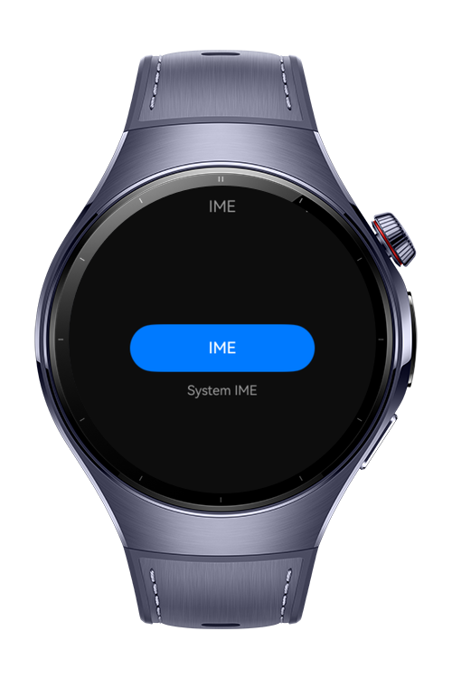
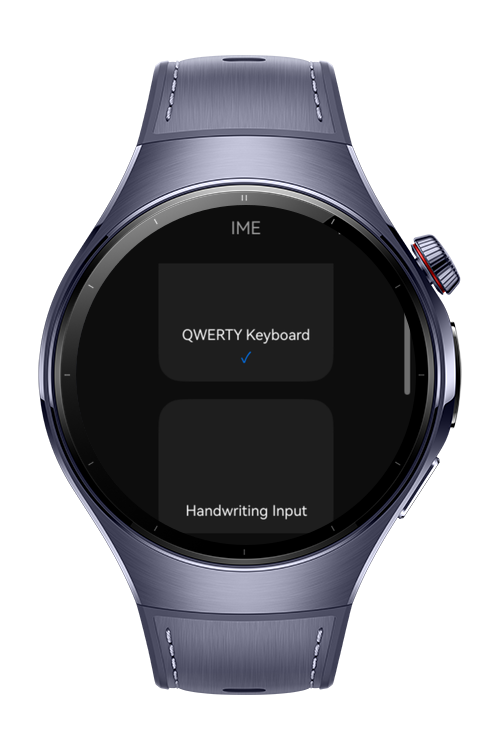

> **Note:** To access all shared projects, get information about environment setup, and view other guides, please visit [Explore-In-HMOS-Wearable Index](https://github.com/Explore-In-HMOS-Wearable/hmos-index).

# How to Build Keyboard Switcher

Keyboard Switcher is a HarmonyOS wearable sample built with ArkTS and ArkUI. The app demonstrates how to list installed input methods, switch the active input method programmatically, open the system IME picker dialog, and control keyboard visibility on a watch using the `@kit.IMEKit` APIs.

# Preview

<div>
  
  
  
</div>

# Use Cases

- List all installed input methods using `inputMethod.getSetting().getInputMethods(true)`
- Switch the active input method with `inputMethod.switchInputMethod()`
- Query the currently active input method with `inputMethod.getCurrentInputMethod()`
- Open the system IME picker dialog via `InputMethodListDialog` component
- Show or hide the software keyboard with `InputMethodController.showTextInput()` and `hideTextInput()`
- Display a compact IME preview card for each available input method
- Fall back to demo data when IME APIs are unavailable in the simulator

# Technology

## Stack

- **Languages**: ArkTS, ArkUI
- **Frameworks**: HarmonyOS Stage Model
- **Tools**: DevEco Studio, Hvigor, ohpm
- **Libraries**:
    - `@kit.IMEKit`
    - `@kit.ArkUI`
    - `@kit.AbilityKit`
    - `@kit.PerformanceAnalysisKit`

## Required Permissions

- `ohos.permission.CONNECT_IME_ABILITY`

# Directory Structure

```
entry/
|   src/
|       main/
|       |   module.json5
|       |
|       |---ets
|       |   |---common
|       |   |       Constants.ets
|       |   |
|       |   |---entryability
|       |   |       EntryAbility.ets
|       |   |
|       |   |---entrybackupability
|       |   |       EntryBackupAbility.ets
|       |   |
|       |   |---model
|       |   |       IMEModel.ets
|       |   |
|       |   |---components
|       |   |       IMEPreviewCard.ets
|       |   |       IMESwitcherList.ets
|       |   |       SystemDialogButton.ets
|       |   |
|       |   |---services
|       |   |       IMEManagerService.ets
|       |   |
|       |   |---pages
|       |           Index.ets
|       |
|       |---resources
|               base/
|               dark/
|
|       test/
|           LocalUnit.test.ets
```

# Constraints and Restrictions

## Supported Device

- Huawei Watch 5
- `inputMethod.switchInputMethod()` requires the `CONNECT_IME_ABILITY` permission and a signed build targeting a physical device.
- `InputMethodController.showTextInput()` / `hideTextInput()` require a focused text input field on some API levels.

# License

**How to Build Keyboard Switcher** is distributed under the terms of the MIT License. See the [LICENSE](LICENSE) for more information.
